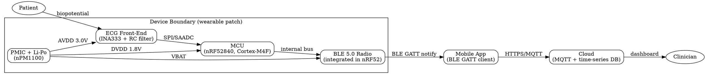

## What I Explored Today

Today I mapped the full signal and power path of a wearable ECG patch from electrode to cloud dashboard, then traced it back through the failure modes each block introduces. The point wasn't to draw a pretty block diagram — it was to establish the *boundary* that tomorrow's DFMEA will analyze. Every block (sensor front-end, MCU, radio, power, mobile app, cloud) is a place where a design decision becomes a potential failure mode, and you can't run a meaningful DFMEA until you can name each interface and what crosses it.

## The Core Concept

A medical IoT device is not one system — it's six subsystems with five interfaces, and *most failures live at the interfaces*, not inside the blocks. The sensor front-end converts a biopotential (say, 0.5–5 mV of ECG) into something an ADC can read. The MCU samples, filters, and decides what to transmit. The radio (BLE, often) moves data to a phone. The phone relays to the cloud. The power subsystem feeds all of them, and its behavior under load directly corrupts the analog front-end.

The "why" of architecture in a DFMEA context: you decompose the system so that each function has an owner and each interface has a defined contract. If the contract is vague ("MCU talks to radio"), you can't enumerate failure modes. If it's precise ("MCU sends 20-byte packets over SPI at 1 MHz, radio ACKs within 5 ms"), you can ask what happens when the ACK is late, the SPI clock glitches, or the battery sags during a TX burst.

The classic trap is treating the analog front-end and the radio as independent. They share a ground plane and a battery. A 2.4 GHz TX burst draws tens of milliamps in microseconds; that current transient couples into your 1 µV-resolution ECG path and shows up as a spike in the waveform. That's an *interface* failure mode, and it's exactly the kind of thing DFMEA is designed to catch before a patient wears the device.

## Key Commands / Configuration / Code

A minimal but realistic architecture sketch as a boundary diagram in Graphviz — this is the artifact you hand to the DFMEA team:



The nRF52840 SAADC config that actually matters for a medical signal — oversampling and gain, not just sample rate:

```c
// nRF5 SDK: SAADC config for ECG, ~250 Hz effective, 12-bit + oversample
nrf_saadc_channel_config_t ch = {
    .resistor_p = NRF_SAADC_RESISTOR_DISABLED,
    .resistor_n = NRF_SAADC_RESISTOR_DISABLED,
    .gain       = NRF_SAADC_GAIN1_4,   // 0..1.2V input range; ECG is small
    .reference  = NRF_SAADC_REFERENCE_INTERNAL, // 0.6V internal ref
    .acq_time   = NRF_SAADC_ACQTIME_40US,       // high-Z electrode source
    .mode       = NRF_SAADC_MODE_SINGLE_ENDED,
    .burst      = NRF_SAADC_BURST_DISABLED,
    .pin_p      = NRF_SAADC_INPUT_AIN0,
    .pin_n      = NRF_SAADC_INPUT_DISABLED,
};
// Oversample 16x in hardware -> effective 14-bit, reduces MCU load
nrf_saadc_oversample_set(NRF_SAADC_OVERSAMPLE_16X);
```

Power budget sanity check — this is the spreadsheet row that decides battery life and, indirectly, whether your TX bursts brown out the analog rail:

```python
# power_budget.py — rough average current for a 7-day ECG patch
blocks = {
    "ECG front-end (INA333)": 0.35,   # mA, always on
    "MCU active (sampling)":   1.20,   # mA, 20% duty
    "BLE TX burst":            5.30,   # mA, 2% duty (peak 8 mA)
    "PMIC quiescent":          0.002,  # mA
}
avg_mA = sum(blocks.values())
capacity_mAh = 200  # small Li-Po
days = capacity_mAh / (avg_mA * 24)
print(f"avg {avg_mA:.2f} mA -> {days:.1f} days")  # ~6.6 days
```

## Common Pitfalls & Gotchas

**1. Sharing an analog and digital ground without a star point.** The ECG front-end's reference must return to a single point near the PMIC, not through the MCU's digital ground. If you skip this, BLE TX bursts appear as baseline wander and you'll chase it for weeks thinking it's a firmware filter bug.

**2. Assuming BLE "just works" as a transport.** GATT notifications are lossy by design — no guaranteed delivery. If your app treats every notification as a sample, you'll silently drop beats. You need a sequence number and either an ACK or a redundant-send scheme, and that decision belongs in the architecture, not bolted on later.

**3. Ignoring the radio's peak current in the power budget.** Averaging 5.3 mA at 2% duty looks fine on paper, but the *instantaneous* 8 mA draw through a high-impedance battery trace causes a voltage droop that resets the MCU or corrupts the ADC. Add bulk capacitance (≥10 µF) at the radio's supply pin and verify with a scope, not a multimeter.

## Try It Yourself

1. **Draw your own boundary diagram.** Take a device you're working on and render it with the Graphviz snippet above. Mark every interface with the *physical* signal (SPI, I²C, RF, power rail) and its voltage/current. If you can't name the interface, you've found a gap.

2. **Build the power budget.** Fill in the Python dict with your real numbers from datasheets. Compute average current and battery life. Then add a column for *peak* current per block and check whether your PMIC and bulk caps can supply it.

3. **Instrument one interface.** Put a scope on the analog supply rail while the radio transmits. Capture the droop. That waveform is a future DFMEA line item — write down the failure mode it represents ("radio TX induces analog rail droop → ECG artifact").

## Next Up

Tomorrow: **DFMEA Planning: Scope, Team & Boundary Diagram for a Wearable Medical Device.** We'll take today's architecture sketch and turn it into the formal boundary diagram that anchors the DFMEA — defining what's in scope, who needs to be in the room (firmware, analog, RF, regulatory), and how to structure the worksheet so it survives an FDA review.
