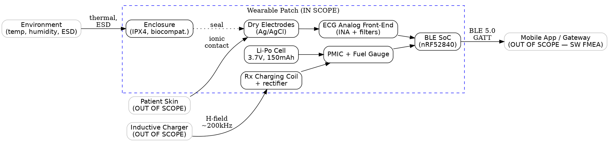

## What I Explored Today

Today I shifted from DFMEA theory into the unglamorous work that determines whether the whole analysis succeeds or collapses into a spreadsheet nobody trusts: planning. For our wearable cardiac telemetry patch (ECG front-end, BLE SoC, Li-Po cell, inductive charging coil, and a mobile app gateway), I defined the DFMEA scope, assembled the cross-functional team, and drafted the boundary diagram. The boundary diagram turned out to be the highest-leverage artifact of the day — it forced arguments about interfaces (charging coil coupling, BLE pairing, electrode-skin contact) into the open *before* anyone started filling in failure modes. Getting scope and boundaries wrong means you either analyze the entire product ecosystem (unbounded, useless) or miss the interfaces where most field failures actually originate.

## The Core Concept

A DFMEA is only as good as its boundary. The boundary diagram is a block diagram that answers three questions: what is inside the analysis, what is outside but interfaces with it, and how do energy, signals, and materials cross that line? For a wearable medical device, the boundary is not just the plastic enclosure. It includes:

- **Physical interfaces**: skin/electrode contact, inductive charging field, thermal path to ambient.
- **Energy interfaces**: battery, charging coil, ESD events from the user.
- **Signal interfaces**: BLE radio link, ECG analog front-end inputs, haptic/alert outputs.
- **Human interfaces**: patient handling, clinician charging, cleaning agents.

The scope statement then declares which of these are *in scope* for this DFMEA and which are handled by a separate analysis (e.g., software FMEA for the app, process FMEA for manufacturing). The team composition follows directly from the boundary: every interface owner needs a seat. If the boundary includes the BLE link, you need someone who owns the radio stack — otherwise you'll write "signal lost" as a failure mode with no credible cause analysis.

The reason this matters for medical devices specifically: IEC 62304 and ISO 14971 require traceability from hazard to design control. A DFMEA with a fuzzy boundary produces failure modes that can't be traced to a requirement or a verification activity, and that's a finding in an audit.

## Key Commands / Configuration / Code

I keep the boundary diagram and scope as version-controlled text so it diffs cleanly and can be rendered in CI. Here's the actual Graphviz source for our patch boundary, plus a YAML scope manifest that feeds our DFMEA tooling.



The scope manifest is what I actually hand to the DFMEA facilitator. It pins the revision of the design inputs so the analysis is reproducible:

```yaml
# dfmea_scope.yaml — Day 6 planning artifact
dfmea:
  id: DFMEA-PATCH-001
  revision: "0.3"
  product: "Cardiac Telemetry Patch, Model CT-100"
  design_inputs_baseline: "DHF-CT100-revC"   # frozen for this analysis
  scope:
    in_scope:
      - "ECG acquisition chain (electrode -> AFE -> SoC)"
      - "Power subsystem (cell, PMIC, charging coil)"
      - "BLE radio link up to antenna"
      - "Enclosure sealing & biocompatibility"
    out_of_scope:
      - "Mobile application software (see SW-FMEA-APP-002)"
      - "Inductive charger hardware (supplier DFMEA)"
      - "Manufacturing process (see PFMEA-MFG-011)"
  boundary_interfaces:
    - {id: IF-01, name: "skin-electrode", type: physical, owner: "Biomaterials Eng"}
    - {id: IF-02, name: "charging H-field", type: energy, owner: "Power Eng"}
    - {id: IF-03, name: "BLE link", type: signal, owner: "RF/FW Eng"}
    - {id: IF-04, name: "thermal to ambient", type: energy, owner: "Mechanical Eng"}
  team:
    - {role: "DFMEA Facilitator", name: "QA Lead"}
    - {role: "Design Owner", name: "HW Lead"}
    - {role: "RF/Firmware", name: "FW Eng"}
    - {role: "Biomaterials", name: "Bio Eng"}
    - {role: "Regulatory", name: "RA Specialist"}
    - {role: "Clinical", name: "Clinical Advisor"}
```

A quick sanity check I run before the kickoff meeting — every interface must have an owner, or the scope is incomplete:

```bash
# Fail if any boundary interface lacks an owner
yq '.dfmea.boundary_interfaces[] | select(.owner == null) | .id' dfmea_scope.yaml \
  && echo "UNOWNED INTERFACE — fix before kickoff" || echo "All interfaces owned"
```

## Common Pitfalls & Gotchas

1. **Drawing the boundary around the enclosure only.** The most consequential failure modes in wearables live at the skin-electrode and charging-coil interfaces. If those are outside your boundary, you've excluded the physics that actually hurts patients. Put every energy/signal crossing *inside* the diagram, even if the counterparty is out of scope.

2. **Inviting only hardware engineers.** A DFMEA team without regulatory and clinical representation will miss failure modes whose severity is defined by patient harm, not by electrical behavior. Severity ratings drift low, and the analysis fails to support ISO 14971 risk management. The clinical advisor is not optional.

3. **Letting the scope float.** If the design inputs baseline isn't frozen (that `design_inputs_baseline` field), the DFMEA becomes a moving target and re-work explodes. Freeze the DHF revision, note it in the scope, and re-baseline explicitly when the design changes.

## Try It Yourself

1. **Draft your own boundary diagram** for a device you're working on using the Graphviz template above. Render it with `dot -Tsvg boundary.dot -o boundary.svg` and check that every energy, signal, and material crossing is labeled.

2. **Write a scope manifest** in YAML with `in_scope`, `out_of_scope`, and `boundary_interfaces`. Run the `yq` ownership check and fix any unowned interfaces before your next team meeting.

3. **Map your team to interfaces.** For each `boundary_interfaces` entry, name the person who owns it. If you can't name someone, that's a gap to resolve before the DFMEA kickoff.

## Next Up

Tomorrow: **Function Analysis & Requirements Traceability for Medical DFMEA** — we'll decompose each in-scope block into its functions, link them to design requirements in the DHF, and build the traceability matrix that keeps every failure mode anchored to a verifiable requirement.
